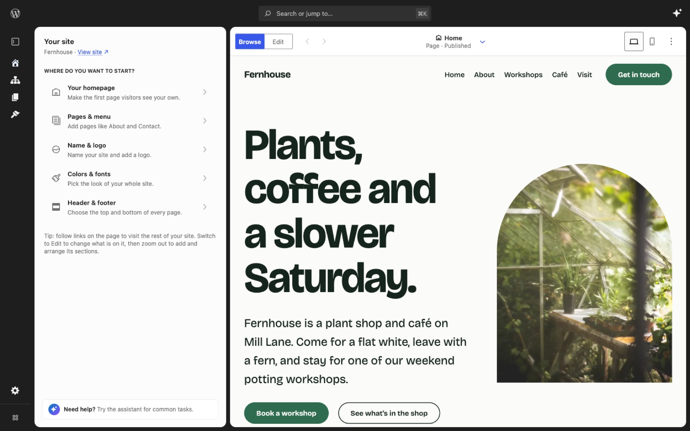

# Create Not Learn Editor

[](https://playground.wordpress.net/?blueprint-url=https://raw.githubusercontent.com/getdave/create-not-learn-editor/trunk/demos/blueprint.json)



[Try Create Not Learn in your browser](https://playground.wordpress.net/?blueprint-url=https://raw.githubusercontent.com/getdave/create-not-learn-editor/trunk/demos/blueprint.json). The demo opens the latest build of `trunk` in the editor, with the Fernhouse demo site ready to edit. There is nothing to install, and your changes go when you close the tab.

Create Not Learn Editor is a standalone WordPress plugin that experiments with a focused, extensible site-editing experience.

The plugin is intentionally not part of the Gutenberg repository. It consumes released WordPress and Gutenberg packages, declares the released Gutenberg plugin as a WordPress plugin dependency, and can be installed like a normal plugin.

## Why This Exists

WordPress core and Gutenberg are moving toward a more extensible Site Editor architecture. Gutenberg currently includes an experimental full-page editor at:

```text
/wp-admin/admin.php?page=site-editor-v2
```

This project mirrors that experiment from the outside, as a plugin. The goal is to learn what can be built by composing the public packages and runtime exposed by the released Gutenberg plugin, without requiring a Gutenberg checkout, patch, submodule, or custom core build.

That matters because a standalone plugin is easier to install, evaluate, ship, and iterate on. It also keeps the experiment honest: if the editor cannot be built from released packages and plugin APIs, that is useful information.

## What It Does Today

The first slice provides a full-page editor shell under:

```text
/wp-admin/admin.php?page=create-not-learn-editor
```

The editor appears in the WordPress admin menu at:

```text
Appearance > Create Not Learn
```

The shell mirrors Gutenberg's `site-editor-v2` experiment setup:

- It registers a hidden admin page.
- It intercepts `admin_init` and renders a standalone full-page HTML document.
- It avoids the normal wp-admin wrapper, sidebar, and footer.
- It uses the Gutenberg `@wordpress/boot` package for the editor frame.
- It uses `@wordpress/route` route modules for navigation.
- It imports WordPress packages from `@wordpress/*` modules and relies on generated asset metadata for runtime dependencies.
- It preserves extension points for route, menu, and boot dependency registration.

The current routes are:

- `/` for the Home route.
- `/types/$type` for a content type landing route.
- `/types/$type/list/$view` for content lists.
- `/types/$type/edit/$id` for editing existing content.
- `/types/$type/new` for creating new content.

Home and Content currently include visible placeholder canvases. They are deliberately simple surfaces so the boot frame, routing, menu, and content list behavior can be developed before replacing the placeholders with richer previews.

## Visual Theme

A small theme layer sits on top of the WordPress Design System. It softens corners, floats the site preview on a quiet backdrop, and tidies a few legacy components, while keeping WordPress's interface font, colors, and dark sidebar.

Headings use EB Garamond, the heading face on [WordPress.org](https://wordpress.org/). The font lives in `assets/fonts/eb-garamond/` under the SIL Open Font License and loads from the plugin, not a third-party CDN.

It is on by default. Switch it with the `CNL_EDITOR_UI_THEME` constant, either `'modern'` or `'default'` (stock WPDS):

```sh
npm run wp-env run cli wp config set CNL_EDITOR_UI_THEME default
npm run wp-env run cli wp config delete CNL_EDITOR_UI_THEME
```

The `create-not-learn-editor_ui_theme` filter can override it too. The theme's settings live in `src/theme/`.

## Site Mutations Are Explicit

The editor does not automatically create pages, navigation, or homepage settings when it loads.

The setup behavior is behind an explicit action:

```text
POST /wp-json/create-not-learn-editor/v1/setup-defaults
```

That action creates or reuses a Home page, sets it as the static homepage, and ensures a basic Navigation menu exists. It is intended to be idempotent.

## Requirements

- WordPress 7.0 or newer.
- PHP 7.4 or newer.
- Gutenberg plugin 24.0.0 or newer.

The plugin header declares:

```text
Requires Plugins: gutenberg
```

WordPress plugin dependencies do not support minimum dependency versions, so the plugin also checks `GUTENBERG_VERSION >= 24.0.0` at runtime. If Gutenberg is missing or too old, the editor page is not registered and an admin notice is shown.

## Development

Install dependencies:

```sh
npm install
```

Start the local WordPress environment:

```sh
WP_ENV_PORT="<dev-port>" WP_ENV_TESTS_PORT="<test-port>" npm run wp-env start
```

Use available non-default local ports for `WP_ENV_PORT` and `WP_ENV_TESTS_PORT`.

The local environment uses WordPress 7.1 with the released Gutenberg 24.0.0 plugin. `npm run wp-env start` downloads these once into a cache that every checkout shares (`~/.cache/create-not-learn-editor/wp-env`), rather than once per checkout.

To try another plugin alongside the editor, such as [Canvas](https://github.com/Automattic/canvas), build it somewhere and map it in a `.wp-env.override.json` next to `.wp-env.json`. The file is ignored by git.

```json
{
	"mappings": {
		"wp-content/plugins/canvas": "~/path/to/canvas"
	}
}
```

Then restart and activate it:

```sh
npm run wp-env start
npm run wp-env run cli wp plugin activate canvas
```

### Shop

With WooCommerce active, "Your site" offers the shop. Map WooCommerce in the same way, activate it, add its pages, then stock the shop with products that cover the awkward cases, like options, stock counts and drafts:

```sh
npm run wp-env run cli wp plugin activate woocommerce
npm run wp-env run cli -- wp wc tool run install_pages --user=1
npm run wp-env run cli -- --env-cwd=wp-content/plugins/<this folder> wp eval-file scripts/demo-site/seed-shop.php
```

### Demo site

The development site (not the tests site) is set up as a demo the first time `wp-env` starts. `scripts/setup-demo-site.mjs` runs after every start and calls `scripts/demo-site/seed.php`, which:

- activates the bundled Mainstay theme (`themes/mainstay/`);
- names the site Fernhouse and fills Home, About, Workshops, Café and Visit pages with the theme's sections;
- adds three journal posts with photos and a menu.

It records that it has run in the `cnl_demo_site_version` option and leaves the site alone after that, so later edits survive restarts. It never overwrites a page someone has changed. When a new version of the demo changes a page's sections, only pages still exactly as the seed left them are updated. To run it again, delete the option and restart:

```sh
npm run wp-env run cli wp option delete cnl_demo_site_version
npm run wp-env start
```

To skip it, start with `WP_ENV_LIFECYCLE_SCRIPT_AFTER_START=true`.

Mainstay is a block theme made for this editor: pages are stacks of full-width sections, each with Soft, Tint, Brand, Contrast and Highlight colour styles for Compose's Colour menu, plus header and footer layouts, page layouts, palettes, font pairings and full looks for Colors & fonts. It lives in this repo but is not part of the plugin zip.

Run the development build watcher:

```sh
npm run dev
```

Create production assets:

```sh
npm run build
```

Create an installable plugin zip:

```sh
npm run plugin-zip
```

Generated `build/` assets and plugin zips are intentionally ignored by git. The source repo is the canonical state; build artifacts are generated when needed.

### Playground demo

The demo link at the top of this README opens [WordPress Playground](https://wordpress.org/playground/) with `demos/blueprint.json`. The blueprint installs Gutenberg, this plugin and the Mainstay theme, runs `scripts/demo-site/seed.php` to build Fernhouse, and lands in the editor.

Playground can't install from the plugin source, which needs building first, or from workflow artifacts. So on every push to `trunk`, `.github/workflows/plugin-zip.yml` builds the plugin zip and publishes it to the `playground-build` branch, along with a zip of the theme and the seed script. The blueprint installs from that branch, so the demo always runs the latest successful build of `trunk`.

Keep the Gutenberg version in the blueprint in step with `.wp-env.json`. Canvas is left out, as the plugin doesn't need it.

#### Branch demos

Every other branch gets a demo of its own too. Each push builds it to `refs/playground/<branch>`, with a `blueprint.json` that installs from there. That ref is neither a branch nor a tag, so the demos stay out of the branch and tag lists. The link for `getdave/my-change` is

```text
https://playground.wordpress.net/?blueprint-url=https://raw.githubusercontent.com/getdave/create-not-learn-editor/refs/playground/getdave/my-change/blueprint.json
```

When a pull request opens, `.github/workflows/playground-links.yml` comments the link on it. The demo follows the branch, updating a few minutes after each push, and is deleted with it.

#### Shop demos

Every build, trunk's, a branch's or a release's, also has a shop demo: the same site with WooCommerce and the Fernhouse shop added, opening on the Shop screen. Swap `blueprint.json` for `blueprint-shop.json` in its link. Trunk's is

```text
https://playground.wordpress.net/?blueprint-url=https://raw.githubusercontent.com/getdave/create-not-learn-editor/playground-build/blueprint-shop.json
```

`scripts/playground-build.sh` writes it from the build's blueprint and the steps in `demos/shop-steps.json`, so the two demos never drift apart.

#### Release demos

The trunk demo changes with every push, which is no good for a user test. For a demo that stays put, tag a release and push the tag:

```sh
git tag v0.2.0
git push origin v0.2.0
```

The workflow builds the tagged commit and publishes its files to a `playground-v0.2.0` tag, with a `blueprint.json` that installs from that tag. That blueprint also pins WordPress to the version in `scripts/wp-env.mjs`, where the trunk and branch demos take the latest. It then creates a GitHub release for `v0.2.0`, or updates one you made already, with the Playground link at the top of the notes and the plugin zip attached. The link is

```text
https://playground.wordpress.net/?blueprint-url=https://raw.githubusercontent.com/getdave/create-not-learn-editor/refs/tags/playground-v0.2.0/blueprint.json
```

Every release keeps its own link, so testers can stay on one while trunk moves on. Pushing the same tag to a new commit rebuilds that release in place.

`scripts/playground-build.sh` puts the files for each kind of demo together.

### Plugin directory images

`.wordpress-org/` holds the images for a WordPress.org plugin directory listing: the icon, the banner and screenshots, named the way the directory expects. They are not part of the plugin zip.

The icon is drawn in `.wordpress-org/icon.svg` and the banner in `scripts/wordpress-org-assets/banner.html`. Both use the Mainstay theme's colours, and the banner borrows its fonts and photos, so the listing looks like the sites the editor makes. After changing either, run `npm run wporg-assets` to render the PNG sizes the directory asks for.

The screenshot at the top of this README is `.wordpress-org/screenshot-1.jpg`. It shows the Fernhouse demo site in a 1440 by 900 window, so retake it from a fresh `wp-env` site when the editor changes.

## Scripts

- `npm run dev` watches and rebuilds development assets.
- `npm run start` is an alias for the same watcher.
- `npm run build` builds production assets.
- `npm run sync:list-view` regenerates the temporary vendored Gutenberg ListView bridge from the pinned `@wordpress/block-editor` package.
- `npm run check:list-view` verifies the committed ListView bridge is current.
- `npm run lint:js` runs JavaScript linting.
- `npm run lint:css` runs stylesheet linting.
- `npm run test:unit` runs the unit tests with Vitest. Its settings live in `vitest.config.mjs`.
- `npm run plugin-zip` creates an installable plugin zip.
- `npm run test:e2e` runs every end-to-end test against the `wp-env` tests site. `test:e2e:smoke`, `test:e2e:views` and `test:e2e:interactions` run one group. See [the end-to-end tests guide](tests/e2e/README.md).
- `npm run wporg-assets` renders the plugin directory icon and banner PNGs in `.wordpress-org/`.
- `npm run wp-env` proxies to `wp-env`, after preparing the shared downloads on `start`.

## Vendored ListView Bridge

Gutenberg's full ListView implementation is currently exposed only as a private `@wordpress/block-editor` API. This plugin temporarily vendors that ListView as a narrow exception to the normal no-copied-source rule.

The vendored source lives in:

```text
src/vendor/gutenberg/list-view
```

Do not edit those files by hand. Regenerate them with:

```sh
npm run sync:list-view
```

The sync script copies from the installed, lockfile-pinned `@wordpress/block-editor` package, applies the minimal local patch in `patches/gutenberg-list-view.patch`, rewrites known internal imports to plugin-local compatibility shims, and writes `provenance.json` with the upstream package version, git head, copied files, and patch checksum.

The local patch is limited to the prototype appender extension points (`renderAppender` and `appenderParentClientId`). When Gutenberg exposes the required ListView API publicly, replace `src/list-view.js` with the public package import and remove this bridge.

## Editor Workarounds

Some behaviour the prototype needs has no supported extension point in the released Gutenberg, so it is reached by leaning on private APIs, core class names, or editor internals. Everything of that kind is listed here. Each entry says what it depends on and what would let it go away, because each one can break on a Gutenberg update.

### Hiding core's "Edit original" toolbar button

Template parts are edited through this plugin's own "Edit Header" button instead, so core's is redundant. Core renders it whenever the `onNavigateToEntityRecord` editor setting is present, and offers no way to suppress it for one block type. Dropping that setting would work but would also take the button away from synced patterns, which still need it.

Instead `src/editor-extensions/template-part-editing.js` adds a `cnl-editor-template-part-selected` class to the admin document body while a template part is the selected block, and `src/style.scss` hides the button's toolbar group in that state.

The whole group is hidden rather than the slot inside it, because a group emptied of its contents still draws its own borders and reads as a broken gap in the toolbar.

Every slot in the toolbar carries the same `block-editor-block-toolbar__slot` class, so the group is picked out as the last one holding a slot, which is where the "other" group is rendered. Earlier slot groups carry controls that should stay, such as block alignment while a part is being edited.

So this depends on three things: the `block-editor-block-toolbar.is-synced` and `block-editor-block-toolbar__slot` class names, the "other" group being rendered last of the slots, and that group holding nothing but "Edit original" for a selected template part.

The replacement is rendered into `__unstableBlockToolbarLastItem`, the slot core's own template part toolbar buttons use, which is what keeps it out of the hidden group.

It also depends on the canvas being portalled into its iframe from the admin document's JavaScript realm, which is what makes `document` there the document the toolbar lives in.

Remove this once the template part block offers a way to opt out of the button.

### Unlocking a template part for in-place editing

The editor sets `disableContentOnlyForTemplateParts` whenever `renderingMode` is `template-locked`, which is the mode pages are edited in. Template parts are therefore not content-only sections there, and `DisableNonPageContentBlocks` additionally locks each part to `contentOnly` and each of its children to `disabled`.

Entering the overlay's edit mode dispatches the private `editContentOnlySection` action, which disables everything outside the part, and then lifts those explicit locks with `setBlockEditingMode( clientId, 'default' )`. Leaving puts them back as `contentOnly` and `disabled`.

The locks are re-read on every change and re-lifted if they come back, because `DisableNonPageContentBlocks` re-applies them whenever a block is added to or removed from the part, which would otherwise strand the author mid-edit.

This assumes the editor keeps locking parts exactly that way. Remove it if template parts become editable in place without the lock, or if the rendering mode stops forcing `disableContentOnlyForTemplateParts`.

### Leaving edit mode by clicking away

`useEditContentOnlySectionExit` in `@wordpress/editor` is meant to handle this, but every block outside the edited section is `inert`, so a click aimed at one never reaches the handler and editing never ends. The same module listens for clicks on the canvas document and ends editing when the click lands outside the part, ignoring popovers so in-canvas UI such as the link editor still works.

Remove it once core's handler fires for clicks on inert blocks.

### Entering edit mode on a second click

A click on an already selected template part enters edit mode. Knowing whether the part was selected *before* the click means reading the store ahead of the editor's own selection handling, so the listener runs in the capture phase on the canvas document, which fires before the editor's handlers at the React root. A first click therefore only ever selects.

Remove it if the editor gains its own click-into-section behaviour for template parts.

### Direct package imports in editor extensions

`src/editor-extensions/` imports each `@wordpress/*` package directly rather than through `src/wordpress-packages.js`, which is the convention everywhere else. The barrel reaches `@wordpress/lazy-editor`, and these modules are registered from app init, so going through it would make the editor a static dependency of page boot and stop it loading lazily.

### Block name label on hover

`includes/block-canvas-styles.php` styles the block wrapper's `data-title` attribute to show a block's name on hover. It depends on that attribute and on the `block-editor-block-list__block` class.

The label normally sits above its block. The topmost block has nothing above it, so the label would be drawn outside the canvas and clipped, which is what hid it on a site header. That one block gets the label just inside its top edge instead, matched through `.is-root-container > .block-editor-block-list__block:first-child`.

Template parts and synced patterns get the label in `--wp-block-synced-color` rather than the admin colour, since they are shared across the site rather than owned by the page. They are matched by `.wp-block-template-part` and `.is-reusable`, the same two selectors core uses to colour its own outline around them.

Both of those rules repeat the base rule's `:not()` chain. Without it the base rule wins on specificity and the override silently does nothing.

## Verification

Before handing off functional changes, run:

```sh
npm run build
npm run check:list-view
npm run lint:js
npm run lint:css
find . -path ./node_modules -prune -o -path ./build -prune -o -path ./.wp-env -prune -o -name '*.php' -print | xargs -n1 php -l
```

When checking runtime behavior, start `wp-env` with explicit local ports and visit:

```text
http://localhost:<dev-port>/wp-admin/admin.php?page=create-not-learn-editor
```

## Repository Shape

- `create-not-learn-editor.php` is the plugin entry point.
- `includes/` contains PHP bootstrap, dependency checks, admin page rendering, REST endpoints, and setup behavior.
- `src/` contains JavaScript route modules, content surfaces, settings helpers, and styles.
- `routes/` contains thin `@wordpress/build` entry wrappers for the editor routes.
- `src/list-view.js` is the stable internal wrapper around the temporary vendored ListView bridge.
- `src/editor-extensions/` contains block editor filters registered at app init, such as template part editing.
- `@wordpress/build` creates the browser bundles and asset metadata under `build/`.
- `.wp-env.json` defines the local WordPress and Gutenberg plugin environment.
- `themes/mainstay/` is the demo block theme the development site uses. `scripts/demo-site/` seeds its content.
- `demos/` holds the WordPress Playground blueprints for the demo link. Branch and release demos are generated from them.
- `.wordpress-org/` holds the plugin directory icon, banner and screenshots.

## Current Design Constraints

- Do not depend on a local Gutenberg repository checkout.
- Do not copy source from Gutenberg into this plugin, except for the scripted ListView bridge under `src/vendor/gutenberg/list-view`.
- Use published `@wordpress/*` packages and runtime modules from the released Gutenberg plugin.
- Import WordPress packages directly from `@wordpress/*`; do not access package APIs through `window.wp`.
- Keep automatic site changes out of editor load.
- Preserve PHP 7.4 compatibility.
- Keep the plugin installable on the latest WordPress release once Gutenberg is installed and active.
